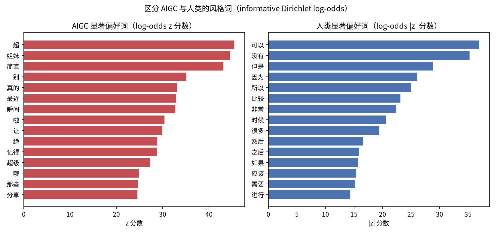
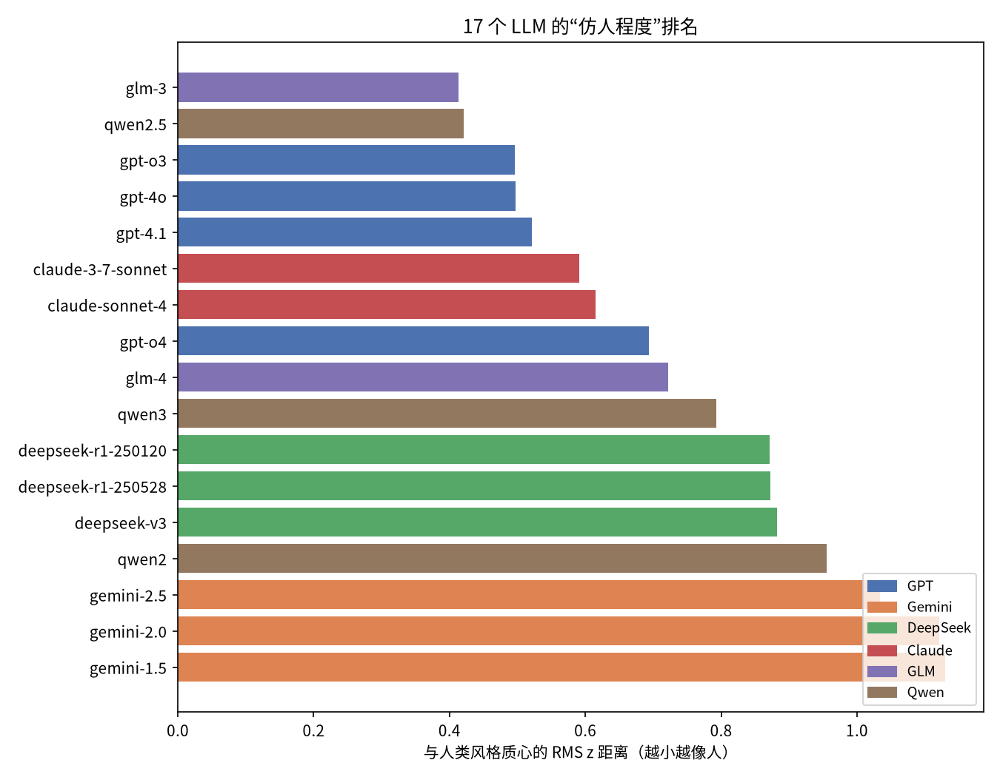
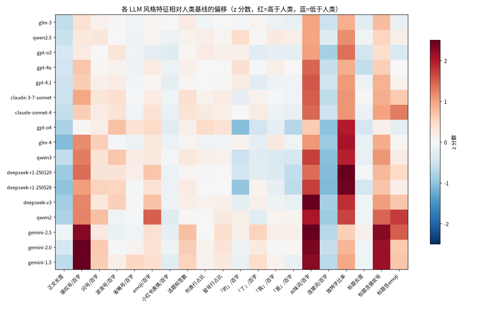
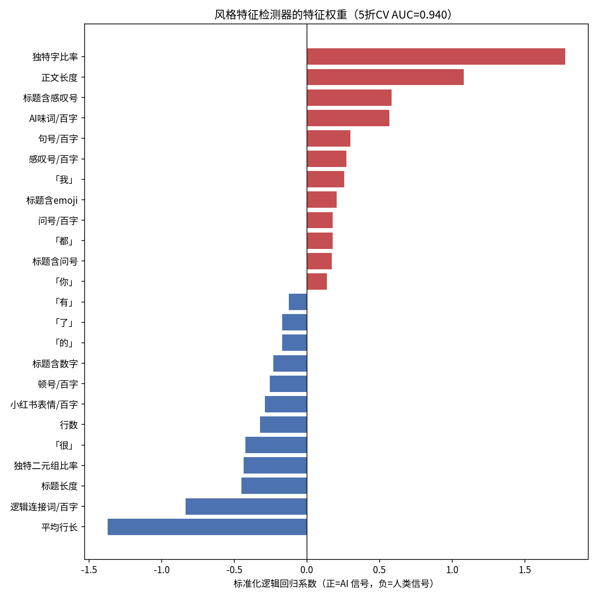
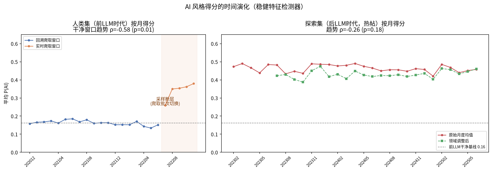
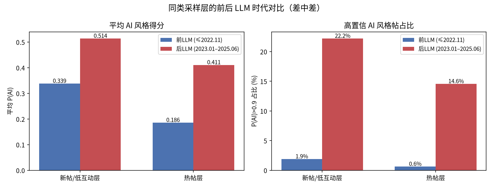
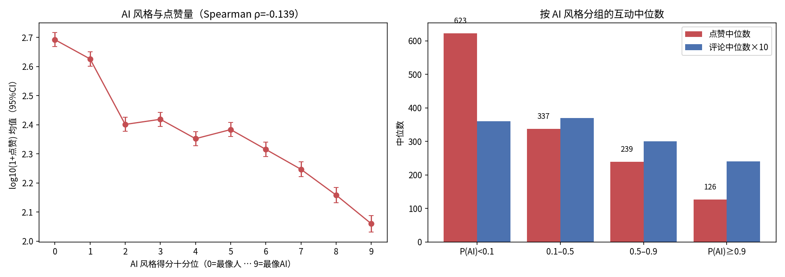

# "AI 味"的解剖、扩散与代价：基于 RedNote-Vibe 的社交媒体 AI 生成文本风格计量研究

**Anatomy, Diffusion, and Cost of the "AI Flavor": A Stylometric Study of AI-Generated Text on Chinese Social Media**

*基于 RedNote-Vibe 数据集（Li et al., 2025）的扩展分析 · 2026 年 6 月*

---

## 摘要

大语言模型（LLM）的普及使 AI 生成文本（AI-Generated Text, AIGT）大量涌入社交媒体，但"AI 味"究竟由哪些可度量的语言特征构成、它在真实平台上以何种速度扩散、以及它对用户互动产生什么影响，仍缺乏系统的实证刻画。本文基于 RedNote-Vibe 数据集——一个覆盖小红书平台 5 年（2020.12–2025.06）、包含 51,878 条前 LLM 时代人类帖子、7,254 条由 17 个 LLM 生成的帖子及 91,517 条后 LLM 时代真实帖子的纵向语料——开展了四项分析。**第一**，通过 informative Dirichlet log-odds 词汇分析与 16 项风格特征的效应量检验，我们给出"AI 味"的操作性解剖：AIGT 显著过用强化语气词（"简直""瞬间""超级"）、营销话术（"宝藏""神器""必备"）与 Unicode emoji，同时显著欠用逻辑连接词（"但是""因为""所以"，Cliff's δ=-0.50）与平台原生表情符（如"[捂脸R]"），呈现出一种"过度营销腔"。**第二**，对 17 个模型构建风格指纹并计算与人类风格质心的距离，发现仿人程度存在显著的厂商差异（GPT≈GLM≈Claude < Qwen < DeepSeek < Gemini，距离越小越像人），且模型更新并不必然提升仿人度（如 GLM-3 优于 GLM-4）。**第三**，仅使用 35 个可解释风格特征的逻辑回归即可实现 AUC=0.940 的人机区分（5 折交叉验证），剔除可能受爬取格式影响的特征后仍达 0.929。**第四**，将该检测器应用于跨时代评分发现：平台内容的 AI 风格水平呈**台阶式跃迁而非渐进漂移**——在控制采样层的差中差比较中，后 LLM 时代帖子的高置信 AI 风格占比从前 LLM 基线的 0.6%–1.9% 跃升至 14.6%–22.2%，而后 LLM 时代内部 31 个月保持平稳；同时我们检测到原数据集人类子集存在一个此前未被报告的采样断层（2022.07），并展示了忽略它会如何扭曲时序结论。**最后**，我们发现显著的"AI 味惩罚"：帖子风格越接近 AIGT，互动越差——最像人的十分位帖子点赞中位数为 785，最像 AI 的十分位仅 106.5（相差 7.4 倍）；该负相关在 82% 的月份×领域单元内成立，且在 2023–2025 间未见减弱。本文所有分析可由仓库内脚本一键复现。

**关键词**：AI 生成文本检测；风格计量学；社交媒体；时序漂移；用户互动；小红书

---

## 1 引言

ChatGPT 发布（2022 年 11 月）以来，LLM 生成内容以前所未有的规模进入社交媒体。中文社区将这类文本可感知的特质俗称为"AI 味"——读者能模糊地"闻到"，却很难说清它由什么构成。已有 AIGT 检测研究大多在静态语料上训练黑盒分类器，存在三点不足：

1. **可解释性缺位**：深度检测器报告高准确率，但无法回答"AI 味是什么"；
2. **时间维度缺位**：检测基准多为单时点快照，无法回答"AI 味以多快的速度渗入真实平台"；
3. **后果维度缺位**：几乎没有工作量化 AI 风格对真实用户互动（点赞、收藏、评论）的影响。

RedNote-Vibe（Li et al., 2025）为弥补这些缺口提供了难得的数据基础：它同时包含**前 LLM 时代的人类帖子**（2020.12–2022.11）、**17 个 LLM 的受控生成帖子**，以及**后 LLM 时代的真实平台帖子**（2022.12–2025.06，含完整互动指标与时间戳）。本文在该数据集上做出如下贡献：

- **C1（解剖）**：用数据驱动的 log-odds 词汇分析和带效应量的特征检验，给出"AI 味"的可操作定义：*强化语气 + 营销话术 + 读者称呼 + 视觉符号堆叠，同时缺失叙事连接词与平台原生表达习惯*（§5.1）。
- **C2（指纹）**：构建 17 个 LLM 的风格指纹，给出仿人度排名与厂商家族差异；发现检测难度与指纹距离一致，且"更新的模型"并不必然"更像人"（§5.2）。
- **C3（检测）**：证明纯可解释特征即可达到 AUC 0.940 的检测性能，给出特征权重的完整披露（§5.3）。
- **C4（扩散）**：通过跨时代评分 + 采样分层差中差设计，刻画 AI 风格在平台上的扩散形态：台阶式跃迁、随后平稳；并发现原数据集的一个采样断层，提示纵向 AIGT 研究必须显式控制采样方式（§5.4）。
- **C5（代价）**：首次在该数据集上量化"AI 味惩罚"：AI 风格得分与互动量显著负相关，且跨时间稳定（§5.5）。

需要强调，本文的检测器度量的是**风格上的 AI 相似度**（AI-likeness）而非作者身份的确证；我们在 §6 中详细讨论这一区分。

## 2 相关工作

**AIGT 检测。** 早期工作利用语言模型自身的统计量进行检测，如 GLTR 的词秩可视化（Gehrmann et al., 2019）与基于概率曲率的 DetectGPT（Mitchell et al., 2023）；监督方法则在人机平行语料上微调分类器，如 HC3（Guo et al., 2023）。这些方法以判别性能为目标，可解释性有限。与之互补，本文沿用风格计量学（stylometry）传统，以人类可读的特征刻画差异，性能虽非最优，但每个判别信号都可被检视。

**LLM 痕迹的群体测量。** Liang et al.（2024）用词频混合模型估计学术评审中被 LLM 修改的比例；Kobak et al.（2024）通过"超额词汇"（如英文学术文本中的 *delve*）追踪 ChatGPT 对学术写作的影响。本文将这一"群体层面痕迹测量"的思路引入中文社交媒体，并利用 RedNote-Vibe 独有的前/后 LLM 时代结构引入了**阴性对照**与**采样分层差中差**设计。

**RedNote-Vibe 数据集。** Li et al.（2025）发布了该数据集并提供 BERT 基线（见仓库 `quick_start.py`）。本仓库此前的探索性分析（见 `README_zh.md`）报告了词频相关性、虚词使用率与用户聚类等结果。本文在其基础上系统化：统一清洗管道、效应量检验、分模型指纹、跨时代漂移与互动效应分析均为新增。

## 3 数据与预处理

### 3.1 数据集

| 子集 | 条数 | 时间范围 | 内容 |
|---|---:|---|---|
| `training_set_human` | 51,878 | 2020.12–2022.11 | 前 LLM 时代人类帖子，10 个领域 |
| `training_set_aigc` | 7,254 | —（无时间戳） | 6 个厂商家族、17 个 LLM 生成的帖子 |
| `exploring_set` | 91,517 | 2022.12–2025.06 | 后 LLM 时代真实帖子，含点赞/收藏/评论 |

AIGC 子集的模型构成：GPT 家族 1,730 条（gpt-4o/4.1/o3/o4），DeepSeek 1,593 条（v3/r1 两版），Qwen 1,250 条（qwen2/2.5/3），Gemini 1,153 条（1.5/2.0/2.5），GLM 792 条（glm-3/4），Claude 736 条（claude-3-7-sonnet/claude-sonnet-4）。

### 3.2 清洗：把"爬取痕迹"与"写作风格"分开

跨子集比较的首要威胁是爬取格式差异。我们发现字面标记 `[话题]`（小红书话题标签的导出残留）在人类集、AIGC 集与探索集中的出现率分别为 5.4%、18.8% 与 **91.7%**——这是采集管道的痕迹而非写作风格。所有分析因此统一执行：

1. 删除全部 `[话题]` 字面标记；
2. 将话题标签 `#xxx` 从正文剥离、单独计数（特征 `n_hashtags`），避免标签堆叠稀释字符级风格统计；
3. 平台原生表情（`[捂脸R]` 等）作为独立特征保留——它在三个子集中都真实存在，是作者行为而非管道痕迹。

### 3.3 发现：人类子集存在采样断层（2022.07）

在按月分析人类子集时，我们发现两个独立信号在 2022 年 7 月同时跳变：（i）"点赞数>0"的帖子占比从此前的约 70% 骤降至约 20%，（ii）AI 风格得分（§4.3）在**每一个领域内部**同步上升 0.13–0.22。唯一能同时解释两者的机制是**爬取批次切换**：2022.06 以前的帖子系回溯式采集（互动量已累积），2022.07–11 的帖子系临近数据集截止时间的实时采集（互动量尚未累积，且新发帖中商业推广类内容占比天然更高）。

因此本文将人类子集划分为**回溯窗口**（2020.12–2022.06，n=37,653，作为"干净前 LLM 基线"）与**实时窗口**（2022.07–11，n=14,225，作为前 LLM 时代"新帖层"的对照），并在所有跨时代比较中按采样层分层（§4.4）。这一断层此前未见报告，我们建议数据集使用者在做任何时序分析时显式处理它。

## 4 方法

### 4.1 风格词表：informative Dirichlet log-odds

为避免手工挑词的主观性，我们用 Monroe et al.（2008）的 informative Dirichlet 先验 log-odds（先验强度 α₀=500，最小词频 30）在 AIGC 全集与人类集 2 万条随机样本之间比较每个词（jieba 分词）的使用倾向，得到 z 分数排序的两个词表（脚本 `paper_lexicon.py`）。从结果中剔除话题相关词（如"穿搭""夏日"）后，将稳定的**风格词**固化为两个特征词表：

- `AI 味词表`（25 词）：简直、瞬间、超级、绝对、宝藏、神器、必备、搞定、轻松、完美、居然、姐妹们、宝子们、家人们、谁懂、绝绝子、拿捏、天花板、闭眼入、亲测、码住、yyds、快冲、冲鸭、记得；
- `逻辑连接词表`（16 词）：但是、因为、所以、如果、然后、之后、比较、应该、需要、对于、能够、时候、很多、没有、非常、可以。

### 4.2 可解释特征集

对每条帖子抽取 35 个特征（脚本 `paper_features.py`），分六组：

1. **长度与结构**：正文长度、行数、平均行长、话题标签数、冒号行占比、列表行占比；
2. **标点密度**（每百字）：感叹号、问号、省略号、波浪号、逗号、顿号、句号；
3. **表情符号**：Unicode emoji 密度与种类数、小红书原生表情密度；
4. **高频虚词密度**（每百字）：的、了、是、我、你、就、都、很、有、不；
5. **词表密度**：AI 味词、逻辑连接词（每百字）；
6. **多样性与标题**：独特字比率、独特二元组比率；标题长度及是否含感叹号/问号/emoji/分隔符"｜"/数字/【】。

### 4.3 检测器与跨时代评分

以人类集为负类、AIGC 集为正类（正类占比 12.3%），训练标准化逻辑回归（类权重均衡，5 折分层交叉验证；脚本 `paper_detector.py`）。同时训练一个**稳健子集模型**（29 特征，剔除话题标签数与全部标题特征，因标题与标签最可能受采集格式影响），用于一切跨数据集的时序评分（脚本 `paper_drift.py`）。模型输出 P(AI)∈[0,1] 解释为**风格上与受控 AIGC 的相似度**。我们以 P(AI)>0.9 定义"高置信 AI 风格帖"，其在干净前 LLM 基线上的占比（0.65%）即为该阈值的经验假阳性率。

### 4.4 差中差（DiD）设计

由于探索集仅收录热帖、人类集含回溯/实时两个采样层，直接比较会混淆"时代效应"与"采样效应"。我们构造两组**同采样层**的前后对比：

- **新帖层**：人类实时窗口（2022.07–11，82% 帖子点赞≤10） vs 探索集中点赞<100 的帖子；
- **热帖层**：人类回溯窗口中点赞>1000 的帖子 vs 探索集中点赞≥1000 的帖子。

若两层都观察到一致的跃升，则结论对采样方式稳健。

### 4.5 统计检验

特征差异用 Mann-Whitney U 检验与 Cliff's delta 效应量（|δ|<0.147 可忽略，<0.33 小，<0.474 中，否则大）；趋势用月度均值对时间序号的 Spearman 相关；互动分析在"月份×领域"单元内计算秩相关以控制混杂（§5.5）。

## 5 结果

### 5.1 "AI 味"的解剖：营销腔过载，叙事连接缺失

**表 1：最具区分度的风格词（每万词使用率）**

| AIGC 偏好词 | z | AIGC | 人类 | | 人类偏好词 | z | AIGC | 人类 |
|---|---:|---:|---:|---|---|---:|---:|---:|
| 姐妹 | +44.5 | 20.6 | 5.7 | | 很 | -37.5 | 23.7 | 51.1 |
| 简直 | +43.1 | 13.3 | 2.3 | | 可以 | -36.9 | 23.7 | 50.6 |
| 真的 | +33.2 | 43.7 | 24.8 | | 没有 | -35.3 | 8.2 | 27.5 |
| 瞬间 | +32.7 | 7.3 | 1.1 | | 但是 | -28.8 | 4.9 | 17.5 |
| 啦 | +30.4 | 26.9 | 13.7 | | 因为 | -26.1 | 5.6 | 16.6 |
| 记得 | +28.8 | 9.4 | 2.8 | | 所以 | -25.0 | 4.6 | 14.5 |
| 超级 | +27.3 | 13.1 | 5.3 | | 比较 | -23.1 | 2.3 | 10.2 |
| 必备 | +23.4 | 5.9 | 1.7 | | 非常 | -22.3 | 2.9 | 10.5 |
| 轻松 | +23.2 | 6.5 | 2.1 | | 时候 | -20.6 | 9.6 | 18.8 |
| 宝藏 | +21.9 | 5.8 | 1.8 | | 然后 | -16.6 | 4.0 | 9.2 |
| 搞定 | +20.6 | 3.2 | 0.6 | | 如果 | -15.7 | 7.3 | 13.2 |
| 绝对 | +20.4 | 5.1 | 1.6 | | 应该 | -15.4 | 1.4 | 5.0 |
| 居然 | +20.0 | 4.3 | 1.2 | | 需要 | -15.2 | 6.8 | 12.3 |
| 神器 | +19.9 | 3.4 | 0.8 | | 进行 | -14.3 | 0.9 | 3.9 |
| 完美 | +19.8 | 5.0 | 1.6 | | 之后 | -15.9 | 2.4 | 6.6 |

两个词表呈现清晰的**语域分化**：AIGC 过用*强化语气词*（简直、瞬间、超级、绝对、完美、居然）、*营销话术*（宝藏、神器、必备、搞定、轻松）与*读者称呼*（姐妹们），而真实人类帖子的标志反而是*平实的叙事连接词与让步/因果结构*（但是、因为、所以、如果、然后、比较、应该）。值得注意的是"非常"属于**人类**偏好词（人类 10.5 vs AIGC 2.9 每万词）——AIGC 不是用"非常"，而是直接跳到"超级/简直/绝绝子"这个强度档位。直观地说：**LLM 在模仿小红书时学会了"种草腔"的最大化版本，却没有学会普通人讲故事时的逻辑黏合剂**。

**表 2：关键特征对比（Mann-Whitney U 检验全部 p<10⁻⁶）**

| 特征 | 人类均值 | AIGC 均值 | Cliff's δ | 效应 |
|---|---:|---:|---:|---|
| 独特字比率 | 0.451 | 0.578 | +0.633 | 大 |
| 逻辑连接词/百字 | 1.104 | 0.448 | -0.501 | 大 |
| 感叹号/百字 | 0.470 | 1.530 | +0.483 | 大 |
| AI 味词/百字 | 0.140 | 0.542 | +0.410 | 中 |
| 正文长度（字） | 472.2 | 320.4 | -0.393 | 中 |
| 标题含感叹号 | 12.6% | 46.3% | +0.337 | 中 |
| emoji/百字 | 0.819 | 1.408 | +0.217 | 小 |
| 话题标签数 | 2.97 | 3.95 | +0.212 | 小 |
| 波浪号/百字 | 0.176 | 0.335 | +0.191 | 小 |
| 「是」/百字 | 1.137 | 0.956 | -0.151 | 小 |
| 小红书表情/百字 | 0.324 | 0.180 | -0.145 | 可忽略† |
| 冒号行占比 | 0.083 | 0.112 | +0.132 | 可忽略 |
| 「的」/百字 | 2.706 | 2.481 | -0.106 | 可忽略 |

†效应量虽小但方向极具诊断意义，见下文。

表 2 中两个细节值得展开。**其一**，AIGC 的感叹号密度是人类的 3.3 倍，近半数标题带感叹号（46.3% vs 12.6%）——"激情过载"是最易感知的 AI 味来源。**其二**，表情符号出现了**符号系统的分化**：AIGC 的 Unicode emoji 密度更高（+72%），但*平台原生*表情码（`[捂脸R]` `[偷笑R]` 等，需要在小红书客户端内点选）反而是人类的用量更高（0.324 vs 0.180）。原生表情属于平台肌肉记忆，提示词很难教会模型；这类**平台特异性习惯**是低成本、难模仿的检测信号。

### 5.2 17 个 LLM 的风格指纹：厂商差异显著，"更新"不等于"更像人"

对每个模型，将其特征均值以人类分布标准化为 z 分数，计算与人类风格质心的 RMS 距离（脚本 `paper_model_fingerprint.py`）。

**表 3：仿人度排名（RMS z 距离，越小越像人）**

| 排名 | 模型 | 家族 | 距离 | | 排名 | 模型 | 家族 | 距离 |
|---:|---|---|---:|---|---:|---|---|---:|
| 1 | glm-3 | GLM | 0.413 | | 10 | qwen3 | Qwen | 0.793 |
| 2 | qwen2.5 | Qwen | 0.421 | | 11 | deepseek-r1-250120 | DeepSeek | 0.872 |
| 3 | gpt-o3 | GPT | 0.496 | | 12 | deepseek-r1-250528 | DeepSeek | 0.872 |
| 4 | gpt-4o | GPT | 0.498 | | 13 | deepseek-v3 | DeepSeek | 0.882 |
| 5 | gpt-4.1 | GPT | 0.521 | | 14 | qwen2 | Qwen | 0.955 |
| 6 | claude-3-7-sonnet | Claude | 0.591 | | 15 | gemini-2.5 | Gemini | 1.034 |
| 7 | claude-sonnet-4 | Claude | 0.616 | | 16 | gemini-2.0 | Gemini | 1.121 |
| 8 | gpt-o4 | GPT | 0.693 | | 17 | gemini-1.5 | Gemini | 1.130 |
| 9 | glm-4 | GLM | 0.722 | | | | | |

家族层面的距离排序为 **GPT (0.50) < GLM (0.54) < Claude (0.60) < Qwen (0.67) < DeepSeek (0.86) < Gemini (1.10)**。三点观察：

1. **厂商差异大于代际差异**。Gemini 全系（3 个版本）都排在末三位，DeepSeek 全系（含两个 R1 版本）聚在 0.87 附近——风格指纹由厂商的后训练配方主导，同厂商各代模型高度相似。
2. **更新不必然更像人**。GLM-3 显著优于 GLM-4（0.413 vs 0.722），qwen2.5 优于 qwen3（0.421 vs 0.793），gpt-o4 劣于 o3/4o。一个可能的解释是：新一代模型经历了更强的指令化/结构化后训练，输出更"工整"，反而偏离了随性的社交媒体语体。
3. **推理模型无优势**。DeepSeek-R1 两个版本与 V3 的距离几乎相同，说明推理能力的增强并未改变其表层风格习惯。

检测难度与指纹距离一致（图见 `paper_figs/family_detection_auc.png`）：用 §4.3 的检测器对"人类 vs 单一家族"做 5 折交叉验证，AUC 为 GLM 0.895 < GPT 0.930 < Claude 0.936 < Qwen 0.959 < DeepSeek 0.981 < Gemini 0.990——**风格上最像人的家族恰好是最难检测的家族**，交叉印证了指纹度量的有效性。

### 5.3 可解释检测器：35 个透明特征达到 AUC 0.940

**表 4：检测性能（5 折分层交叉验证）**

| 模型 | 特征数 | AUC | F1 | 准确率 |
|---|---:|---:|---:|---:|
| 全特征逻辑回归 | 35 | **0.940** | 0.626 | 0.873 |
| 稳健子集（无标签数/标题特征） | 29 | 0.929 | 0.605 | — |

F1 偏低源于类不平衡（正类仅 12.3%）下均衡类权重在 0.5 阈值处的过召回，AUC 是更恰当的总评指标。作为参照，原数据集论文的 BERT 基线属于黑盒语义模型；本文的意义不在刷新精度，而在证明**仅凭人类可读的表层风格特征就能解释绝大部分人机可分性**——即"AI 味"主要是表层风格现象，而非深层语义现象。

多元权重（图示）与单变量效应（表 2）方向基本一致：最强的人类信号是*平均行长*（人类成段书写，AIGC 高频换行的"卡片式排版"）与*逻辑连接词密度*；最强的 AI 信号是*独特字比率*与*AI 味词密度*。注意"正文长度"在多元模型中系数为正（AI 信号），与单变量方向（AIGC 更短）相反——这是控制了与长度强负相关的独特字比率之后的条件效应，提醒读者解读多元系数需谨慎。

### 5.4 扩散形态：台阶式跃迁，而非渐进漂移

用稳健子集模型对人类集（按月）与探索集（按月）评分：

**阴性对照成立**：干净回溯窗口（2020.12–2022.06，19 个月）的月均 P(AI) 稳定在 0.13–0.19 区间，趋势甚至略降（ρ=-0.58, p=0.009），高置信占比仅 0.65%——前 LLM 时代不存在向"AI 风格"的自发漂移，检测器也未把"时间"误当作特征。图中橙色段即 §3.3 的采样断层（实时爬取窗口，0.26→0.38）；若不分离该断层，会得到"风格漂移早于 ChatGPT 发布"的错误结论。

**跨时代为台阶**：探索集自有数据起点（2023.02）即处于 0.44–0.49 的高位，是干净基线（0.16）的约 3 倍；高置信占比 17.6%（基线 0.65%）。

**后 LLM 时代内部为平台期**：探索集 31 个月里月均得分无显著单调趋势（原始 ρ=-0.26, p=0.18；领域调整后 ρ=+0.38, p=0.07；高置信占比 ρ=+0.29, p=0.12）。2023 上半年（0.476 / 17.3%）与 2025 上半年（0.454 / 17.6%）几乎持平。

**表 5：分采样层的跨时代对比（差中差）**

| 采样层 | 前 LLM | 后 LLM | Δ均值 | 高置信占比变化 | p |
|---|---:|---:|---:|---|---:|
| 新帖/低互动层 | 0.339 | 0.514 | **+0.176** | 1.9% → 22.2%（11.6×） | <10⁻³⁰⁰ |
| 热帖层 | 0.186 | 0.411 | **+0.225** | 0.6% → 14.6%（24×） | 8×10⁻²⁴ |

差中差消除了"探索集只收热帖""新帖天然更商业化"两类采样混杂：**无论比较新帖还是热帖，后 LLM 时代的 AI 风格水平都跃升约 +0.18 至 +0.23**，高置信占比放大一个数量级以上。同时探索集内部呈现清晰的梯度——互动越低的帖子 AI 味越重（点赞<100 层 22.2% vs 1k–10k 层 13.7%），提示 AI 风格内容更多堆积在平台的低互动尾部。

单特征的季度演化（`paper_figs/drift_features_quarterly.png`）补充了一个微妙信号：综合得分平稳的表象下，探索集的*逻辑连接词密度*仍在缓慢下降（季度 ρ=-0.75）、*正文长度*缩短（ρ=-0.92）、*独特字比率*上升（ρ=+0.68），三者皆朝 AIGC 基线方向移动；而最招摇的"AI 味"标志（感叹号 ρ=0.08、AI 味词 ρ=0.13）持平。一种解释是：随使用深入，AI 痕迹正从"一眼可见的语气词"转向"更深层的句法与信息密度特征"——这对依赖表层词表的检测方法是预警。

### 5.5 "AI 味惩罚"：风格越像 AI，互动越差

在探索集（2023.01–2025.06，n=91,481）内：

- **总体负相关**：P(AI) 与 log 点赞的 Spearman ρ=-0.139（p<10⁻³⁰⁰）；收藏 ρ=-0.132；评论 ρ=-0.052。
- **控制混杂后依然成立**：在 141 个"月份×领域"单元（每单元 n≥100）内分别计算秩相关，加权平均 ρ=-0.091，**82% 的单元为负**——不是领域构成或爬取批次的假象。
- **梯度大且单调**：按 P(AI) 十分位分组，点赞中位数从最像人组的 **785** 单调降至最像 AI 组的 **106.5**（7.4 倍）；四分组的点赞/收藏/评论中位数（表 6）同样单调。

**表 6：按 AI 风格分组的互动中位数（探索集）**

| 分组 | n | 点赞 | 收藏 | 评论 |
|---|---:|---:|---:|---:|
| P(AI)<0.1（最像人） | 22,668 | 623 | 240 | 36 |
| 0.1–0.5 | 27,640 | 337 | 157 | 37 |
| 0.5–0.9 | 25,107 | 239 | 111 | 30 |
| P(AI)≥0.9（最像 AI） | 16,066 | 126.5 | 48 | 24 |

- **惩罚跨时间稳定**：逐月 ρ 无显著时间趋势（p=0.31，图 `paper_figs/engagement_rho_monthly.png`），即截至 2025 年中，没有证据表明读者对 AI 风格"脱敏"或平台分发对其"豁免"。

值得注意的是评论的惩罚（ρ=-0.05）明显弱于点赞与收藏（ρ≈-0.13）：点赞/收藏度量内容的*被认可与留存价值*，而评论更多由话题争议性驱动——AI 味损害的主要是前者。

### 5.6 稳健性检验

**长度匹配。** 人类帖子平均更长，可能质疑 §5.1 的风格差异只是长度的代理。把两集放入共同的正文长度区间（150–1000 字共 5 箱，每箱两组 n≥283），六个核心特征的差异方向与效应量在全部箱内保持稳定：AI 味词密度 δ=+0.37…+0.50、逻辑连接词密度 δ=-0.42…-0.52、感叹号 δ=+0.43…+0.53、emoji δ=+0.21…+0.30、小红书表情 δ=-0.06…-0.17、独特字比率 δ=+0.52…+0.71（图 `paper_figs/robustness_length_matched.png`）。长度混杂不能解释这些差异。

**领域一致性。** 在 10 个领域内分别做 Mann-Whitney U 检验与 Cliff's delta（图 `paper_figs/robustness_effect_consistency.png`）：12 个核心特征中 10 个在全部 10 个领域内方向一致；列表行占比 8/10 领域同向（中位 δ=+0.05），"的"与"是"分别 9/10 领域内更低（中位 δ=-0.13/-0.16），仅单个领域反向。人/机风格差异是跨领域稳定的现象，而不是领域构成的混杂。

**跨领域迁移。** 留一领域实验（训练时剔除目标领域，在该未见领域上测试）得到 AUC 0.914（运动）–0.949（健康），样本量加权均值 0.937，与全数据 5 折 CV 的 0.940 几乎一致（图 `paper_figs/robustness_domain_transfer.png`）。检测器提取的是跨领域的"AI 味"风格信号，而非领域词汇表。

**检测器不确定性。** 对 5 折 CV 得分做 1000 次 bootstrap，AUC 的 95% 置信区间为 0.937–0.943（点估计 0.940）；PR 曲线 AP=0.803（正类基线 12.3%）；在 P≥0.9 工作点上 precision=0.87、recall=0.56（图 `paper_figs/robustness_precision_recall.png`）。

**阈值敏感性。** 把"高置信"阈值从 0.9 放宽/收紧到 0.5、0.7、0.95，台阶形态不变：干净前 LLM 窗口在四个阈值下的占比为 8.5%/3.4%/0.65%/0.29%，探索集各半年窗口相对其放大约 5.1–5.3 倍、8.6–9.7 倍、24.4–28.6 倍与 41.9–47.9 倍，且 2023–2025 内部各窗口占比基本持平（表 7、图 `paper_figs/robustness_threshold_sensitivity.png`）。§5.4 的"台阶式扩散"结论不依赖单一阈值选择。

**表 7：不同阈值下"高于阈值占比"（%）**

| 时期 | n | >0.5 | >0.7 | >0.9 | >0.95 |
|---|---:|---:|---:|---:|---:|
| 干净前 LLM（2020.12–2022.06） | 37,653 | 8.5 | 3.4 | 0.65 | 0.29 |
| 前 LLM 实时窗口（2022.07–11） | 14,225 | 26.9 | 11.7 | 1.9 | 0.6 |
| 探索集 2023H1 | 1,088 | 45.2 | 30.4 | 17.3 | 12.3 |
| 探索集 2023H2 | 2,191 | 43.5 | 29.1 | 15.9 | 12.3 |
| 探索集 2024H1 | 11,129 | 45.1 | 31.7 | 18.6 | 13.9 |
| 探索集 2024H2 | 20,638 | 44.1 | 30.7 | 17.1 | 12.3 |
| 探索集 2025H1 | 56,435 | 45.4 | 32.7 | 17.6 | 12.2 |

## 6 讨论

**风格相似 ≠ 作者身份。** 本文的 P(AI) 度量"与受控 AIGC 的风格距离"。后 LLM 时代高置信占比 17.6% 不应读作"17.6% 的帖子是 AI 写的"：其中既包含真正的 AIGT，也包含模仿爆款腔调的人类写手（AI 风格本身就源于训练语料中的种草文）、以及人机协作内容。更准确的表述是：**平台上"AIGC 同款风格"的流通量在 LLM 普及后立即跃升了一个数量级，并稳定在新平台期**。反过来，逐字润色的轻度 AI 使用也可能逃逸检测——17.6% 同时是某种下界与上界的混合体，我们倾向将其视为风格渗透率而非作者占比。

**为什么是台阶而不是斜坡？** 工具可得性几乎是一夜之间的（ChatGPT 上线两个月破亿用户），而探索集 2023 年初的样本已显示高位。配合 §5.4 的特征级演化（表层标志平稳、深层特征仍在缓动），我们的解读是：*采用率的跃迁在 2023 年初已基本完成，其后的变化是风格的精细化而非数量的继续扩张*。当然，2023 年早期月份样本较小（每月 159–404 条），对"台阶起点"的定位精度有限。

**AI 味惩罚的两种机制。** 负相关可能来自（a）**读者侧**：用户能感知营销腔过载并降低互动意愿；（b）**供给侧**：批量生产的 AIGT 多为低成本营销内容，即使风格无害也缺乏真实经验细节，且可能被平台降权。本文的观察设计无法分离两者，但两种机制都指向同一实践结论：**对内容生产者，套用"AI 味"模板在互动意义上是负资产；对平台，风格检测器可作为低质内容召回的廉价一级筛**。

**对检测研究的提示。** （i）平台原生表达（如 `[xxR]` 表情）是被忽视的强信号源；（ii）逻辑连接词的*缺失*比强化词的*出现*更稳定（后者易被提示词压制，前者要求模型真正掌握叙事习惯）；（iii）纵向研究必须显式建模采集方式——本文若未发现 2022.07 采样断层，会把爬取批次效应误读为"ChatGPT 发布前的风格漂移"。

## 7 局限性

1. **AIGC 子集的生成条件未知细节**：提示词模板可能系统性影响风格（如要求"小红书风格"会推高 emoji 与感叹号），模型排名应理解为"该数据集生成配置下"的排名。
2. **探索集只含热帖**：差中差缓解但不能完全消除选择偏差；低互动层的对照（人类实时窗口）时间跨度仅 5 个月。
3. **无真值标签**：后 LLM 时代帖子无人机标注，无法计算检测器在真实分布上的精确率；0.65% 的基线假阳性率仅在干净前 LLM 分布上成立。
4. **特征工程的文化特异性**：词表与表情特征为小红书/中文定制，结论外推到其他平台需重新校准。
5. **观察性研究**：互动惩罚是相关而非因果；理想的因果识别需要平台侧实验或断点设计。

## 8 结论

本文以 RedNote-Vibe 为基础，把"AI 味"从一种直觉变成了一组可度量、可检验、可追踪的语言学对象：它由强化语气、营销话术、视觉符号过载与叙事连接词缺失构成（C1）；它在不同厂商的模型上强度不同，且不随版本更新单调减弱（C2）；35 个透明特征即可以 AUC 0.940 将其与人类文本区分（C3）；它在 ChatGPT 发布后数月内以台阶形式涌入平台、高置信占比放大 11–24 倍、随后三年保持平台期（C4）；而平台用户用脚投票——AI 味每深一个十分位，互动就低一截，三年未变（C5）。

对创作者，这些结果是一句朴素的写作建议：少一点"简直绝绝子"，多一点"但是、因为、后来"。对平台与研究者，这是一条方法论提醒：检测 AI，不仅要看它写了什么，更要看它*没有*写什么。

## 参考文献

1. Li, Y., Sun, Y., Yao, Y., Yang, P., Li, W., Zou, J., Huang, Y., & Shen, L. (2025). *RedNote-Vibe: A Dataset for Capturing Temporal Dynamics of AI-Generated Text in Social Media*. arXiv:2509.22055.
2. Monroe, B. L., Colaresi, M. P., & Quinn, K. M. (2008). Fightin' Words: Lexical Feature Selection and Evaluation for Identifying the Content of Political Conflict. *Political Analysis*, 16(4), 372–403.
3. Gehrmann, S., Strobelt, H., & Rush, A. M. (2019). GLTR: Statistical Detection and Visualization of Generated Text. *ACL 2019 (Demo)*.
4. Mitchell, E., Lee, Y., Khazatsky, A., Manning, C. D., & Finn, C. (2023). DetectGPT: Zero-Shot Machine-Generated Text Detection using Probability Curvature. *ICML 2023*.
5. Guo, B., Zhang, X., Wang, Z., Jiang, M., Nie, J., Ding, Y., Yue, J., & Wu, Y. (2023). How Close is ChatGPT to Human Experts? Comparison Corpus, Evaluation, and Detection. arXiv:2301.07597.
6. Liang, W., Izzo, Z., Zhang, Y., et al. (2024). Monitoring AI-Modified Content at Scale: A Case Study on the Impact of ChatGPT on AI Conference Peer Reviews. *ICML 2024*.
7. Kobak, D., González-Márquez, R., Horvát, E.-Á., & Lause, J. (2024). Delving into ChatGPT usage in academic writing through excess vocabulary. arXiv:2406.07016.
8. Ippolito, D., Duckworth, D., Callison-Burch, C., & Eck, D. (2020). Automatic Detection of Generated Text is Easiest when Humans are Fooled. *ACL 2020*.
9. Jawahar, G., Abdul-Mageed, M., & Lakshmanan, L. V. S. (2020). Automatic Detection of Machine Generated Text: A Critical Survey. *COLING 2020*.
10. Cliff, N. (1993). Dominance statistics: Ordinal analyses to answer ordinal questions. *Psychological Bulletin*, 114(3), 494–509.
11. Mann, H. B., & Whitney, D. R. (1947). On a Test of Whether one of Two Random Variables is Stochastically Larger than the Other. *Annals of Mathematical Statistics*, 18(1), 50–60.

## 附录 A：复现指南

所有脚本位于仓库根目录，依次运行即可复现全部数字与图表（Python ≥3.10，依赖见 `requirements.txt`：jieba/numpy/pandas/scikit-learn/scipy/matplotlib）；也可直接运行 `python3 run_paper_pipeline.py` 按顺序执行以下 8 步：

| 步骤 | 脚本 | 产物 |
|---|---|---|
| 1. 词表发现 | `paper_lexicon.py` | `paper_lexicon_results.json` |
| 2. 特征抽取 | `paper_features.py` | `paper_features_{human,aigc,exploring}.csv.gz` |
| 3. 模型指纹 | `paper_model_fingerprint.py` | `paper_model_results.json` + 2 图 |
| 4. 检测器与检验 | `paper_detector.py` | `paper_detector_{results,model}.json` + 2 图 |
| 5. 时序漂移 | `paper_drift.py` | `paper_drift_results.json`、逐帖得分 + 3 图 |
| 6. 补充图 | `paper_extra_figs.py` | 修正时间线、差中差、词表图 |
| 7. 互动分析 | `paper_engagement.py` | `paper_engagement_results.json` + 2 图 |
| 8. 稳健性检验 | `paper_robustness.py` | `paper_robustness_results.json` + 5 图（长度匹配/领域一致性/跨领域迁移/PR/阈值敏感性） |

## 附录 B：探索集分领域 AI 风格水平（2023.01–2025.06）

| 领域 | n | 平均 P(AI) | 高置信占比 |
|---|---:|---:|---:|
| 未知 | 16,978 | 0.538 | 25.0% |
| 旅行 | 8,692 | 0.490 | 14.1% |
| 健康 | 9,763 | 0.490 | 18.5% |
| 运动 | 1,598 | 0.486 | 22.0% |
| 美食 | 2,538 | 0.483 | 21.9% |
| 职场 | 8,730 | 0.469 | 14.2% |
| 宠物 | 1,831 | 0.432 | 17.0% |
| 心理 | 11,804 | 0.430 | 10.8% |
| 情感 | 15,740 | 0.429 | 17.8% |
| 学习 | 1,168 | 0.393 | 12.8% |
| 穿搭 | 12,675 | 0.360 | 16.6% |

未标注领域（"未知"）的帖子 AI 风格水平最高，与"低成本批量内容更少做领域归类"的猜想一致；穿搭类最低，可能因其高度依赖真实出片与个人身材描述，AI 模板的适配成本更高。
